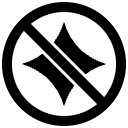

#  DropKick

**DropKick – hide the floating AI bar in Shopify Admin.**

A Chrome extension that gets Shopify Admin's floating **"Work with Sidekick"** bar out of the way.
You can hide it, or replace it with a **Sidekick** item in the left sidebar, just above **Settings**.

| Mode | What it does |
| --- | --- |
| **Show in original position** | Default. Leaves Shopify Admin untouched. |
| **Move to left sidebar** | Hides the floating bar and adds a Sidekick item above Settings that matches Shopify's own nav items, including in the collapsed nav. Clicking it (or Enter/Space) opens Sidekick's panel. |
| **Hide** | Hides the floating bar. |

## Install

DropKick isn't on the Chrome Web Store yet. To load it from source:

1. Download or clone this repository.
2. Open `chrome://extensions` and turn on **Developer mode**.
3. Click **Load unpacked** and select the `extension` folder.
4. Pin DropKick from the toolbar's puzzle-piece menu, then click it on any Shopify Admin page to pick a mode.

Your choice syncs with your Chrome profile and applies to open admin tabs immediately.

## Privacy and permissions

DropKick runs only on `https://admin.shopify.com/*`. It makes no network requests, collects nothing,
and never reads or changes your store's data.

- `storage` saves the selected mode.
- `scripting` and access to `admin.shopify.com` let the extension update tabs that are already open
  when it's installed or updated, so you don't need to refresh them.

## How it works

- **Hide** is a single CSS rule, so it also covers Sidekick loading late or being re-rendered.
- **Sidebar** clones Shopify's own Settings nav item at runtime, so it picks up Shopify's current
  styling, and swaps in Shopify's Sidekick icon. Clicking it presses Sidekick's own "open panel"
  button, which is still in the page, just hidden. A `MutationObserver` re-adds the item whenever
  Shopify re-renders the nav.
- Shopify's own elements are never moved or edited. Switching back to the original mode leaves the
  page exactly as Shopify rendered it.

## Maintaining

Shopify can change its admin markup at any time. DropKick deliberately avoids Shopify's generated
class names and translated labels. It relies only on these hooks:

| Selector | Used for |
| --- | --- |
| `[data-frame-footer-outlet="center"]` | Container of the floating bar |
| `[data-sidekick-field]` | Sidekick's input field (in the bar, or in the open panel) |
| `[data-floating-sidekick-page-feather]` | Gradient behind the bar |
| `[data-sticky-bottom-nav] a[href$="/settings"]` | Settings nav item, cloned for the sidebar item |
| `button:has(s-internal-icon[type="layout-sidebar-right"])` | Sidekick's "open panel" button |
| `s-internal-icon[type="sidekick"]` | Sidekick icon used in the sidebar item |
| `[name="sidekickMessage"]` | Message box focused when the panel is already open |

If one of these disappears, DropKick quietly stops doing anything and never breaks the page. The
selectors are defined at the top of [`extension/content.js`](extension/content.js) and
[`extension/content.css`](extension/content.css).

## Development

Requires Node.js 20 or newer.

```bash
npm install
npm test
```

The tests load the real extension in Chrome for Testing (via Puppeteer) against a local replica of
the Shopify Admin markup in `test/fixture/`. They never contact Shopify. Pass
`-- --grep <pattern>` to run some of the tests, or `-- --headful` to watch the browser.

`npm run icons` regenerates the icons in `extension/icons/`.

## Limitations

- Verified on desktop Chrome with an English-language admin. The selectors don't depend on
  language, but other locales and the mobile layout haven't been tested by hand.
- The sidebar item appears only when Sidekick is available for the store.

## Disclaimer

DropKick is an independent project. It isn't affiliated with, endorsed by or sponsored by Shopify.
Shopify and Sidekick are trademarks of Shopify Inc.

## License

[MIT](LICENSE)
